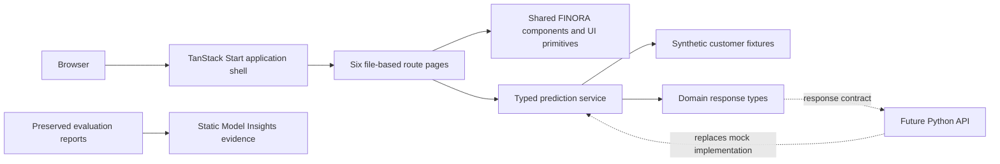
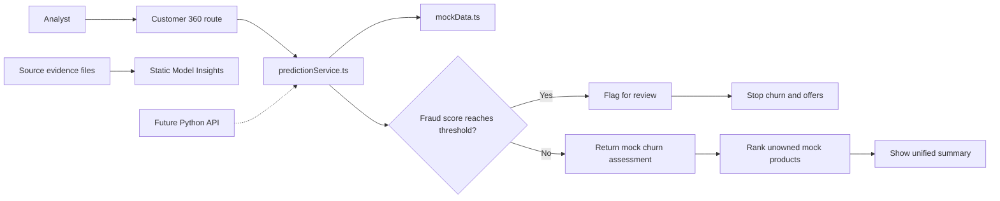

# FINORA — Beyond the Numbers

FINORA is a responsive banking-intelligence **frontend prototype** that brings transaction review, customer-retention context and ownership-aware product recommendations into one analyst experience. Its centerpiece is a guided Customer 360 flow that screens a synthetic transaction first, then—only when the transaction is not flagged—shows synthetic churn context and eligible mock offers.

> **Prototype only.** Interactive predictions are deterministic demonstrations, not results from the supplied Python models. FINORA is not a banking system, fraud detector, credit decision system, or production decisioning tool.

**Live application:** [finora-ai.manus.space](https://finora-ai.manus.space)

## Contents

- [What FINORA does](#what-finora-does)
- [Architecture](#architecture)
- [Customer 360 decision flow](#customer-360-decision-flow)
- [Demo data and prediction behavior](#demo-data-and-prediction-behavior)
- [Evaluation evidence and provenance](#evaluation-evidence-and-provenance)
- [Responsible use and known limitations](#responsible-use-and-known-limitations)
- [Technology](#technology)
- [Project structure](#project-structure)
- [Run locally](#run-locally)
- [Test, build and lint](#test-build-and-lint)
- [Production container](#production-container)
- [Future Python API integration](#future-python-api-integration)
- [Contributing and licensing](#contributing-and-licensing)

## What FINORA does

The app opens on **Overview** and includes six routes:

| Page                                                     | Features                                                                                                                                                                                                                                   |
| -------------------------------------------------------- | ------------------------------------------------------------------------------------------------------------------------------------------------------------------------------------------------------------------------------------------ |
| **Overview** (`/`)                                       | Demo-only portfolio KPIs, synthetic churn-risk and scenario distributions, recent demo activity, and shortcuts to Customer 360 and the model pages.                                                                                        |
| **Customer 360** (`/customer-360`)                       | Select one of 20 synthetic profiles, run fraud screening first, stop on a flagged result, or continue to synthetic churn risk and the top three eligible mock offers. Successful flows end with a unified profile/risk/offer summary.      |
| **Fraud Detection** (`/fraud-detection`)                 | Select and screen a synthetic transaction; view its mock score, the stored artifact threshold used for demonstration, review status, sourced fraud-artifact metrics, and three synthetic review-path examples.                             |
| **Customer Churn** (`/customer-churn`)                   | Select a synthetic customer, run a mock churn assessment, view the probability and risk band, and see profile-based demo context cues. The cues are fixture rules, not feature attribution.                                                |
| **Product Recommendations** (`/product-recommendations`) | View a customer’s owned products, run the mock ranking, and show the top three products after excluding products already owned. High synthetic churn risk changes the heading to “Retention Offers”; other bands use “Recommended Offers.” |
| **Model Insights** (`/model-insights`)                   | Compare the available fraud, churn and recommendation evaluation evidence; show product-level offer metrics, feature contracts, provenance and caveats; explain the frontend/backend boundary.                                             |

The app uses a shared FINORA sidebar, customer selectors, profile and owned-product panels, page headers, risk indicators, probability bars, accessible tables, and responsive layouts. It does not require login and does not save analyst/customer state to a database.

## Architecture

FINORA separates presentation, synthetic records, prediction orchestration, domain contracts and evaluation evidence. The interactive UI calls one service module; components do not calculate scores. The displayed evaluation evidence is static and is **not** produced by the demo scoring service.



### Main layers

1. **Application shell and routing** — TanStack Start provides server rendering and TanStack Router’s file-based page routing. The root shell applies global styles, top bar, sidebar, React Query provider, error handling, and nested route outlet.
2. **Routes and presentation** — Pages in `src/routes/` compose FINORA components and existing accessible UI primitives. They maintain user-interface state such as selected customer, loading state, and displayed result.
3. **Shared UI** — `src/components/finora/` contains the navigation, customer selector, profile/ownership panels, formatting helpers, risk badges and workflow stepper. `src/components/ui/` contains the reusable Radix/shadcn-style primitives.
4. **Synthetic data** — `src/data/mockData.ts` contains 20 fictional customer profiles in seven demo scenarios, a five-product catalogue, recent demo activity and lookup helpers.
5. **Prediction service** — `src/services/predictionService.ts` provides deterministic mock fraud, churn, and offer responses; calculates overview aggregates; filters owned products; and orchestrates the fraud-first Customer 360 decision flow.
6. **Domain types** — `src/types/finora.ts` defines the customer, fraud, churn, churn-context, offer, activity and combined Customer 360 response contracts. These are the intended UI boundary for a future API.
7. **Evaluation evidence** — `docs/evidence/` preserves the supplied churn classification report and recommendation metrics JSON. Model Insights presents manually transcribed report values; it does not load those files to score the demo profiles or independently validate their claims.
8. **SSR runtime** — Vite and Nitro build a Node server output. `Dockerfile` installs the pinned frontend dependencies, builds the app and runs `.output/server/index.mjs`.

### Request and data flow



## Customer 360 decision flow

1. **Select a demo customer.** The selector offers all 20 synthetic profiles. Overview activity links can open Customer 360 with a selected profile.
2. **Run fraud screening first.** The service returns a deterministic mock probability and compares it with the decision cutoff copied from supplied fraud-artifact metadata (`0.9386608004570007`, approximately 93.866%). The probability is mock data—the threshold is displayed for workflow consistency only.
3. **Stop on a flagged result.** The report contains no churn or offers (`null` for both). The interface shows a review alert and explains that a score is a risk signal, not proof of fraud.
4. **Continue only when not flagged.** The service returns a synthetic churn probability and band: **Low <30%**, **Medium 30–60% (inclusive at 60%)**, **High >60%**. It then generates a ranked set of eligible mock products.
5. **Exclude owned products and summarize.** Owned products are filtered out before ranking. At most three remaining products appear. High churn risk uses “Retention Offers”; Low and Medium use “Recommended Offers.” The final card summarizes the customer, fraud result, churn context and top offer.

The standalone fraud page and Customer 360 share the same fraud prediction service. The standalone churn and product pages run their respective service actions independently; the offer page obtains a synthetic churn band to select the heading before ranking mock offers.

## Demo data and prediction behavior

All customer names, balances, transactions and scenario labels are fictional. The data is included to demonstrate UI states and should not be interpreted as observed customer behavior or a representative bank portfolio.

`predictionService.ts` uses deterministic per-customer generation so the same profile gives consistent mock outputs across reloads. It simulates asynchronous service latency for loading states. In detail:

- **Fraud screening:** mock scores are designed to exercise both continue and review-stop paths. The stored fraud threshold is sourced from the supplied artifact metadata, but the browser does not load or execute that model. The `demoTrueFraud` fixture marker is not used to calculate predictions.
- **Churn assessment:** probabilities are synthetic rule-based outputs with deterministic variation. The accompanying “Demo context cues” are explanatory fixture rules, not SHAP values, feature importance, causal drivers, or model explanations.
- **Offer ranking:** each of the five products receives a synthetic propensity score from profile-based demo rules with deterministic variation. Already-owned products are removed before sorting; the three highest-ranked remaining offers are returned.
- **Overview statistics:** KPIs and charts are aggregates of the synthetic fixtures and mock outputs, not financial or operational performance statistics.

The mock service is for front-end development and demonstration only. It does not make HTTP requests, use the model artifacts, persist results, or make eligibility/pricing/credit decisions.

## Evaluation evidence and provenance

The figures below are reproduced from the evidence supplied with the project. They are not recalculated in FINORA, and the current interactive scores are not predictions from these evaluation runs.

### Fraud artifact metadata

The supplied serialized fraud artifact contained these metrics:

| Metric           | Reported value |
| ---------------- | -------------: |
| Precision        |         83.28% |
| Recall           |         60.83% |
| F1               |         70.31% |
| PR-AUC           |         75.71% |
| Stored threshold |        93.866% |

The project documentation describes a Kaggle-style schema with `Time`, `V1`–`V28`, and `Amount`. The supplied XGBoost artifact instead expects a different 17-field merchant/demographic schema. That data-contract/provenance mismatch must be resolved before backend integration. The frontend does not load the artifact. A confusion matrix was not supplied.

### Churn classification report

The supplied report lists test support of 2,000 total rows: 1,607 for class 0 and 393 for class 1. Values shown here are the report’s rounded values.

| Classifier    | Test accuracy | Class 1 precision | Class 1 recall | Class 1 F1 |
| ------------- | ------------: | ----------------: | -------------: | ---------: |
| Random Forest |           86% |               74% |            47% |        58% |
| XGBoost       |           87% |               74% |            50% |        59% |
| CatBoost      |           87% |               74% |            49% |        59% |
| LightGBM      |           87% |               75% |            49% |        59% |
| SVC           |           86% |               73% |            47% |        57% |

For CatBoost, the report also shows 8,000 training rows (class 1 support 1,644): training accuracy 88%, class 1 precision 83%, recall 53%, F1 64%; test accuracy 87%, class 1 precision 74%, recall 49%, F1 59%. The report does **not** identify the dataset, split method, target mapping (whether class 1 means churn), or decision threshold. Until those details are verified, describe these as classification-report results, not confirmed churn performance. The original is preserved at `docs/evidence/churn_classification_reports.txt`.

### Product recommendation model report

The supplied `offer_metrics.json` lists CatBoost as `best_model`, with reported mean PR-AUC 0.4346, mean ROC-AUC 0.6346, and Precision@1 0.628. It compares ten candidate models:

| Model                                | Mean PR-AUC | Mean ROC-AUC | Precision@1 |
| ------------------------------------ | ----------: | -----------: | ----------: |
| CatBoost (file’s reported selection) |      43.46% |       63.46% |       62.8% |
| XGBoost                              |      43.19% |       63.12% |       63.1% |
| Random Forest                        |      42.97% |       64.22% |       62.8% |
| SVM (RBF)                            |      42.87% |       63.12% |       62.3% |
| Gradient Boosting                    |      42.85% |       64.09% |       62.6% |
| Bagging                              |      41.92% |       61.96% |       59.4% |
| AdaBoost                             |      41.90% |       63.50% |       59.7% |
| Decision Tree                        |      41.66% |       62.71% |       43.7% |
| KNN                                  |      40.87% |       61.61% |       58.0% |
| Logistic Regression                  |      38.88% |       63.58% |       31.3% |

CatBoost has the highest reported mean PR-AUC, but not the highest value for every aggregate metric: XGBoost has the highest Precision@1 (63.1%); Random Forest has the highest mean ROC-AUC (64.22%). The JSON does not document the dataset, evaluation split, sample counts, Precision@1 definition, or model-selection protocol.

CatBoost’s per-product results are:

| Product            | Supplied base rate | PR-AUC | ROC-AUC |
| ------------------ | -----------------: | -----: | ------: |
| Personal Loan      |              9.60% | 98.66% |  99.77% |
| Securities Account |             10.45% |  9.80% |  48.83% |
| CD Account         |              6.05% | 19.55% |  70.46% |
| Online             |             59.68% | 59.64% |  49.48% |
| CreditCard         |             29.42% | 29.64% |  48.78% |

Performance is uneven. Securities Account PR-AUC is below its supplied base rate; Online PR-AUC is essentially equal to its base rate and its ROC-AUC is near 0.50. CreditCard ROC-AUC is also near 0.50. Interpret per-product metrics alongside prevalence and the missing evaluation details—not from the aggregate alone. The original JSON is preserved at `docs/evidence/offer_metrics.json`.

## Responsible use and known limitations

- **No live model inference:** serialized Python model files are not loaded or executed by this application or browser.
- **No live bank integration:** there is no authentication, database, transaction feed, customer API, account linking, logging pipeline, or model-serving endpoint in this frontend deployment.
- **Scores are not decisions:** fraud mock outputs are review-path demonstrations, not proof of fraud. Do not use them to approve, block, or decline transactions.
- **Churn and offer outputs are synthetic:** do not use them to make real decisions about people, customers, credit, product eligibility, pricing, or retention interventions.
- **Evidence is not independently verified:** the churn and recommendation results are transcribed from supplied files; source details are incomplete as described above. Model Insights presents static evidence, not fresh evaluation.
- **Separate source datasets:** the fraud, churn, and recommendation model families were trained separately. The synthetic demo profiles connect the UI flows, not real multi-model customer records.
- **Resolve schema and governance first:** before operational use, verify dataset provenance, label definitions, feature mappings, train/test methodology, calibration, threshold selection, fairness, privacy, security, monitoring, human oversight, and applicable governance requirements.

## Technology

| Area                | Technology                                                              |
| ------------------- | ----------------------------------------------------------------------- |
| UI                  | React 19, TypeScript, Tailwind CSS 4                                    |
| Routing and SSR     | TanStack Start and TanStack Router                                      |
| Development/build   | Vite 8, Nitro 3 `node-server` preset                                    |
| Components          | Radix UI primitives with shadcn-style wrappers; Lucide icons            |
| Client data utility | TanStack Query provider (the prototype itself uses local demo fixtures) |
| Package manager     | pnpm 11.25.0, pinned in `package.json`                                  |
| Container runtime   | Node.js 22, defined in `Dockerfile`                                     |

## Project structure

```text
.
├── Dockerfile                         # Node SSR production container
├── .dockerignore                      # Keep local build context small and exclude secrets
├── README.md                          # Project overview, architecture and operating notes
├── package.json                       # Scripts, dependencies and pinned pnpm version
├── pnpm-lock.yaml                     # Reproducible dependency lockfile
├── pnpm-workspace.yaml                # Allow-listed dependency build scripts (esbuild)
├── vite.config.ts                     # TanStack/Vite config and Nitro node-server target
├── public/
│   ├── manus-routes.json              # Declared website route manifest
│   ├── favicon.png
│   └── robots.txt
├── docs/evidence/
│   ├── churn_classification_reports.txt # User-supplied classification reports
│   └── offer_metrics.json             # User-supplied offer-model evaluation metrics
└── src/
    ├── assets/                        # FINORA logo and icon
    ├── components/
    │   ├── finora/                    # App shell navigation and reusable FINORA panels
    │   └── ui/                        # Reusable accessible interface primitives
    ├── data/mockData.ts               # Synthetic customers, products and activity
    ├── routes/                        # Six page routes plus root route and app shell
    ├── services/predictionService.ts  # Mock scoring and fraud-first orchestration
    ├── types/finora.ts                # Domain and response contracts
    ├── styles.css                     # Global styles and design tokens
    ├── router.tsx                     # Router configuration
    └── test/                           # Route and prediction-service tests
```

`src/routeTree.gen.ts` is generated by the TanStack routing plugin; avoid editing it manually. `.gitignore` excludes local environment files, dependencies, logs, and generated build output.

## Run locally

Requirements: **Node.js 22+** and **pnpm 11.25.0**. Corepack can activate the project’s pinned pnpm version.

```bash
corepack enable
corepack prepare pnpm@11.25.0 --activate
pnpm install --frozen-lockfile
pnpm dev
```

Open the local address printed by Vite. No `.env` file, database, Python environment, or model downloads are required for the frontend demonstration.

## Test, build and lint

```bash
pnpm test       # Run Vitest tests (routes, fraud gate, offer ownership filter and risk bands)
pnpm lint       # Run ESLint
pnpm build      # Build the production TanStack Start/Nitro app
```

The production output is `.output/`. To run that Node server locally after building:

```bash
PORT=3000 node .output/server/index.mjs
```

On Windows PowerShell, set the variable first with `$env:PORT = "3000"`, then run `node .output/server/index.mjs`.

## Production container

The project is an SSR application, not a static site: the build produces a server entry and client assets rather than a standalone root `index.html`. `vite.config.ts` pins Nitro to `node-server`; the container installs dependencies from the committed pnpm lockfile, builds the app, and starts `.output/server/index.mjs`. The server honors `PORT` (default `3000`).

To build and run the included container locally, with Docker installed:

```bash
docker build -t finora .
docker run --rm -p 3000:3000 -e PORT=3000 finora
```

The managed deployment serves the frontend only. It does not enable a database or add a Python inference service. For the managed project, the production health endpoint is `/`.

## Future Python API integration

The intended replacement point is `src/services/predictionService.ts`. A future backend could replace the mock implementations with API calls while keeping the current TypeScript response types in `src/types/finora.ts` and leaving the page components largely unchanged.

Before that integration:

1. Reconcile each model’s training schema with the actual API feature schema, particularly the documented fraud PCA schema versus the supplied artifact’s different 17-field schema.
2. Verify churn class labels, recommendation labels, dataset provenance, metric definitions, evaluation protocol and threshold selection.
3. Define and version explicit request/response schemas for fraud, churn, recommendations and portfolio summaries.
4. Validate and normalize each model’s fields server-side; do not send `demo*` scenario labels or synthetic ground-truth markers to a model.
5. Preserve the fraud-first gate on a trusted server as well as in the UI; a flagged report must not contain downstream churn/offers.
6. Return probabilities as numbers in `[0, 1]`, include model/version/evaluation metadata where appropriate, and apply authentication, privacy, monitoring, human review, and governance controls before any real use.

There are no Python API routes or backend endpoints in this project today; the interface above is an integration direction, not an existing service contract on the network.

## Contributing and licensing

Keep demo records separate from presentation components, keep prediction logic behind the service boundary, and preserve the provenance/limitations next to evaluation results. Run the tests, linter and production build before proposing changes. No open-source license is included in this repository; add a license file before redistributing it under open-source terms.
